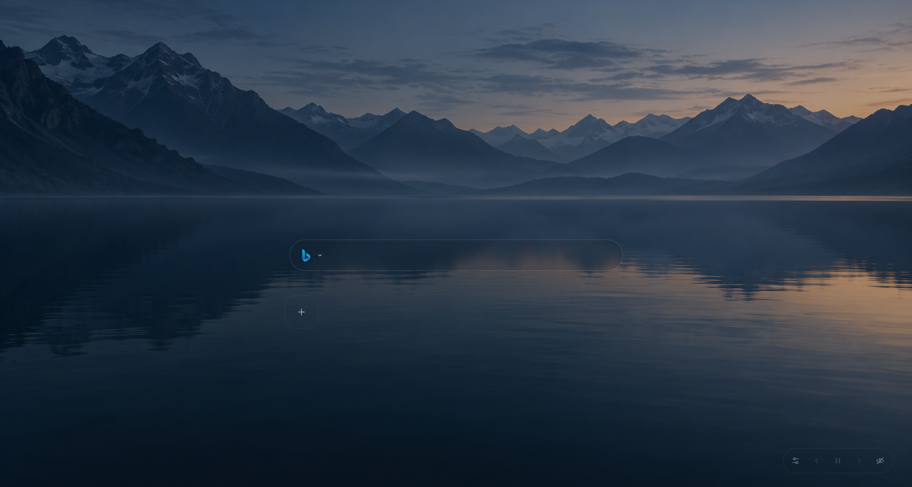

# Startpage

一个浏览器起始页，使用原生 HTML、CSS 和 JavaScript 构建。无需构建工具、后端服务或账号，支持直接在本地打开。



项目附带一张 AI 生成的[示例壁纸](wallpapers/example.png)，[生成提示词](wallpapers/example.prompt.txt)也保存在 `wallpapers/` 中。

## 功能

- **多引擎搜索**：在 Bing、Google 和百度之间切换，按回车搜索。
- **本地快捷链接搜索**：按名称或域名匹配已保存链接，最多显示 5 项；输入时不发送网络请求。
- **快捷链接**：添加、编辑、删除链接，支持自定义 SVG 图标与长按拖动排序。
- **壁纸轮播**：支持手动切换、自动播放与暂停，默认每 30 秒切换一次。
- **外观调节**：实时调整透明度、背景模糊、填充色和边线色，每行链接数量可设为 5–10 个。
- **壁纸配色**：跟随预先提取的壁纸主题色，也可随时手动调色。
- **搜索聚焦**：轻微模糊、压暗周围区域并淡化图标，搜索框保持明亮。
- **沉浸模式**：隐藏搜索框与快捷链接，专注欣赏壁纸。
- **本地保存**：设置与快捷链接保存在浏览器本地，无需登录。

## 快速开始

使用现代浏览器直接打开 `index.html`，或者在项目根目录启动本地静态服务（需安装 Python）：

```bash
python -m http.server 8000
```

然后访问 [http://localhost:8000/](http://localhost:8000/)。也可将整个目录部署至静态网站托管服务，保持文件相对路径不变。

## 操作说明

| 操作 | 方法 |
| --- | --- |
| 切换搜索引擎 | 点击搜索框左侧 Logo |
| 搜索 | 输入关键词，按回车 |
| 聚焦搜索框 | 页面打开后自动聚焦；也可在非输入状态按 `/` |
| 打开匹配链接 | 输入名称或域名，用 ↑ / ↓ 选择结果，按回车；也可直接点击结果 |
| 强制网页搜索 | 按 Shift + Enter，即使已选中匹配链接也使用搜索引擎 |
| 收起搜索结果 | 按 Esc；搜索框聚焦时也会退出聚焦效果 |
| 添加快捷链接 | 将鼠标移至快捷链接末尾的空位，点击出现的 `+` |
| 编辑或删除链接 | 将鼠标移至卡片右侧编辑按钮位置，点击图标 |
| 排序链接 | 长按卡片约 420ms 后拖动，松手保存 |
| 调整外观 | 点击右下角工具栏的调节图标 |
| 关闭外观设置 | 点击面板外部或按 Esc |
| 恢复默认外观 | 点击设置面板标题旁的“恢复默认” |
| 跟随壁纸配色 | 勾选外观设置底部的“跟随壁纸取色” |
| 切换壁纸或暂停轮播 | 使用右下角的箭头与播放控制按钮 |
| 切换沉浸模式 | 点击可见性按钮；将鼠标移至工具栏位置可再次显示控制按钮 |

外观设置自动保存，默认值为 **80% 透明度、5px 背景模糊、每行 6 个链接**。搜索结果未选中时，直接按回车始终执行网页搜索。

手动修改填充色或边线色会自动取消跟随壁纸配色；调整透明度或模糊度不会退出跟随模式。

## 更新壁纸

### 1. 添加图片

将图片放入项目的 `wallpapers/` 目录。脚本**不会递归扫描嵌套目录**，可用的图片按文件名自然排序加入清单（例如 `2.png` 排在 `10.png` 前）。

支持扫描的扩展名：

```text
.jpg .jpeg .png .webp .gif .bmp .avif .tif .tiff
```

实际解码能力取决于图片库，显示能力取决于浏览器，建议优先使用 PNG、JPEG 或 WebP。

### 2. 生成清单

在项目根目录运行：

```bash
python update_wallpapers.py
```

Windows 下可使用 PowerShell 和系统自带的 `System.Drawing`，无需额外安装依赖。其他系统需要安装 Pillow；Windows 下遇到系统解码器不支持的格式时，也可安装 Pillow：

```bash
python -m pip install Pillow
```

安装后重新运行更新命令。脚本始终以自身位置定位 `wallpapers/`，不受当前工作目录影响。

### 3. 刷新页面

脚本会在项目根目录生成 `wallpapers.js`，包含带 `wallpapers/` 前缀的图片路径、文件名标识、遮罩强度与主题色。增删、重命名或替换图片后，需要重新运行脚本并刷新页面。

所有图片处理成功后才会替换清单；图片无法解码或目录缺失时，保留原清单并报错。空的 `wallpapers/` 目录会生成空清单。

主题色提前计算，因此以 `file://` 方式打开页面时也能使用自动配色。

## 项目结构

```text
startpage/
├── index.html           # 页面结构与对话框
├── style.css            # 毛玻璃样式、布局与交互状态
├── script.js            # 搜索、快捷链接、壁纸与外观设置
├── wallpapers.js        # 自动生成的壁纸清单与主题色
├── update_wallpapers.py # 扫描 wallpapers/ 并更新清单
├── README.md
├── LICENSE
└── wallpapers/
    ├── example.png
    ├── example.prompt.txt
    ├── misty-lake.png
    └── misty-lake.prompt.txt
```

## 数据与隐私

- 设置与快捷链接存储在当前浏览器的 `localStorage` 中，项目不会将其上传至服务器。
- 搜索时，关键词会发送至所选搜索引擎；打开快捷链接会访问对应网站。
- 输入时的链接匹配完全在本地完成，不会请求搜索建议服务。
- 清除浏览器站点数据会清除已保存设置。不同浏览器、浏览器配置或访问地址之间的数据不会自动同步。
- `file://` 下的本地存储行为取决于浏览器。移动 HTML 文件或改用 HTTP 地址后，可能无法读取原地址的设置。

## 常见问题

**新图片没有出现在轮播中？**

确认图片直接位于 `wallpapers/` 中，运行 `python update_wallpapers.py` 后刷新。若浏览器缓存了旧清单，可尝试强制刷新。

**背景模糊不明显？**

需要浏览器支持 `backdrop-filter`，并将模糊度设为大于 0。纯色背景下的模糊效果也会较弱。

## 贡献

欢迎通过 Issue 反馈问题，或通过 Pull Request 提交改进。反馈视觉或交互问题时，请附上浏览器版本、复现步骤和截图。

## 许可

项目代码采用 [MIT 许可证](LICENSE)。

壁纸图片与第三方 Logo 遵循各自权利人的授权；MIT 许可证不额外授予这些素材的使用权。
