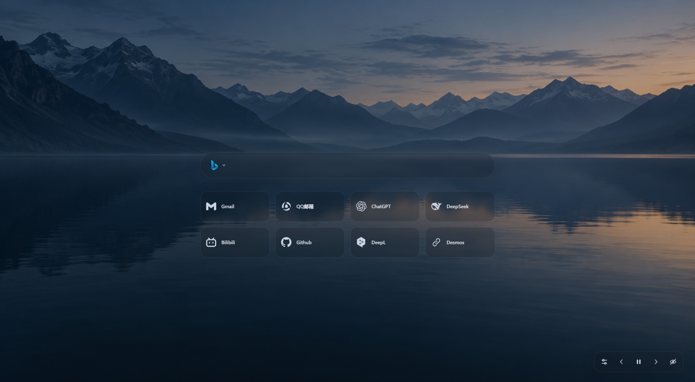

# Startpage

A lightweight, wallpaper-first browser start page built with plain HTML, CSS, and JavaScript. No build step, backend, or account required.



*The preview above shows the page. An AI-generated [example wallpaper](wallpapers/example.png) and its [generation prompt](wallpapers/example.prompt.txt) are included in `wallpapers/`.*

## Features

- **Search engines** - Switch between Bing, Google, and Baidu from the search box logo. Press Enter to search.
- **Quick links** - Add, edit, and delete shortcuts, use custom SVG icons, and reorder cards by dragging.
- **Wallpaper slideshow** - Browse wallpapers manually or play a slideshow with 30-second intervals.
- **Appearance controls** - Adjust transparency, background blur, fill color, and border color across panels.
- **Wallpaper colors** - Follow precomputed wallpaper palettes or adjust either color to switch back to manual styling.
- **Focused search** - Gently dim surrounding content while keeping the search box bright.
- **Immersive mode** - Hide the search box and shortcuts to enjoy your wallpaper.
- **Local preferences** - Keep settings and shortcuts in your browser's local storage.

## Getting started

1. Download the project.
2. Keep `startpage.html` and `wallpapers.js` in the project root, with images inside `wallpapers/`. Preserve this directory structure.
3. Open `startpage.html` in a modern browser.

You can set the page as your browser homepage. Replacing the new tab page may require an extension, depending on your browser.

**Python is only needed to regenerate the wallpaper list and palettes.** The page runs without it.

Alternatively, serve the directory locally:

```bash
python -m http.server 8000
```

Open [http://localhost:8000/startpage.html](http://localhost:8000/startpage.html).

> The current page interface is in Simplified Chinese. This documentation is in English.

## Usage

| Action | How |
| --- | --- |
| Choose a search engine | Click the logo on the left of the search box |
| Search | Type a query and press Enter |
| Add a shortcut | Hover over the empty slot after your shortcuts and click `+` |
| Edit or delete a shortcut | Hover over the edit button area on the right side of a card |
| Reorder shortcuts | Hold a card for approximately 420ms, then drag and release |
| Change appearance | Click the adjustment icon in the bottom-right toolbar |
| Close appearance settings | Click outside the panel or press Esc |
| Reset appearance | Click the reset action beside the panel title |
| Follow wallpaper colors | Enable the checkbox at the bottom of appearance settings |
| Browse or pause wallpapers | Use the toolbar navigation and playback buttons |
| Toggle immersive mode | Click the visibility button; hover over the toolbar area to reveal it again |

Appearance settings save automatically. Defaults are **80% transparency** and **5px background blur**.

Editing either color disables automatic wallpaper colors. Changing transparency or blur leaves automatic colors enabled.

## Updating wallpapers

### 1. Add your images

Place images in the `wallpapers/` directory beside `update_wallpapers.py`. The script scans **only images directly inside `wallpapers/`**, without searching nested directories, and sorts filenames naturally: `1.png`, `2.jpg`, `10.jpg`.

Recognized extensions:

```text
.jpg .jpeg .png .webp .gif .bmp .avif .tif .tiff
```

Actual decoding support depends on the image library, and display support depends on the browser. PNG, JPEG, and WebP are recommended.

> Keep documentation images, such as the root-level `screenshot.jpg`, outside `wallpapers/`. They will not be included in the slideshow.

### 2. Regenerate the list

Requires Python 3.8 or later:

```bash
python update_wallpapers.py
```

On Windows, the script can use PowerShell and the built-in `System.Drawing` library without additional packages. On other platforms, install Pillow. Pillow can also help with formats unsupported by the Windows decoder:

```bash
python -m pip install Pillow
```

Run the update command again after installation. The script always resolves `wallpapers/` relative to its own location, regardless of your working directory.

### 3. Refresh the page

The script generates `wallpapers.js` in the project root with `wallpapers/`-prefixed image paths, stable filename keys, shading values, and theme colors. Run it again whenever you add, remove, rename, or replace images, then refresh the page.

The existing list is replaced only after every image is processed successfully. If an image cannot be decoded, the previous list is preserved. An empty `wallpapers/` directory produces an empty list. A missing directory reports an error and preserves the existing list.

Palettes are computed ahead of time, so automatic colors work when opening the page with `file://`; the browser does not need to read image pixels.

## Project structure

```
startpage/
|-- startpage.html       # Page, styles, interactions, and embedded engine SVGs
|-- wallpapers.js        # Generated wallpaper list and palettes
|-- update_wallpapers.py # Scans wallpapers/ and updates wallpapers.js
|-- screenshot.jpg       # README preview; excluded from the slideshow
|-- README.md
|-- LICENSE
|-- wallpapers/
    |-- 1.png / 2.jpg / ...
    |-- example.png
    |-- example.prompt.txt
```

The page initializes search, search focus, shortcuts, wallpapers, and appearance separately. Panels share appearance variables; inner controls remain transparent to avoid stacking tint and blur.

`wallpapers.js` loads through a regular script tag, keeping the project usable without a local server.

## Data and privacy

- Preferences and shortcuts are stored in the browser's `localStorage`. The project does not upload them to a server.
- Searching sends your query to the selected search provider. Opening a shortcut visits its destination website.
- Clearing browser site data removes saved preferences. Data does not automatically sync between browsers, browser profiles, or page addresses.
- Local storage behavior under `file://` depends on the browser. Moving the HTML file or switching to an HTTP address may make previously saved preferences unavailable.

## Troubleshooting

**New images do not appear**

Check that the images are directly inside `wallpapers/`, run `python update_wallpapers.py`, and refresh. Try a hard refresh if the browser caches the previous list.

**Colors change when the wallpaper changes**

Automatic wallpaper colors are enabled. Edit the fill or border color to switch to manual colors, or disable the checkbox directly.

**Background blur is missing**

Use a browser that supports `backdrop-filter` and set blur above zero. Blur is less noticeable over flat backgrounds.

## Contributing

Issues and pull requests are welcome. For visual or interaction bugs, include your browser version, reproduction steps, and a screenshot.

## License

The project code is licensed under the [MIT License](LICENSE).

Wallpaper images and third-party logos remain subject to their respective owners' rights and licenses; the MIT License does not grant additional rights to those assets.
